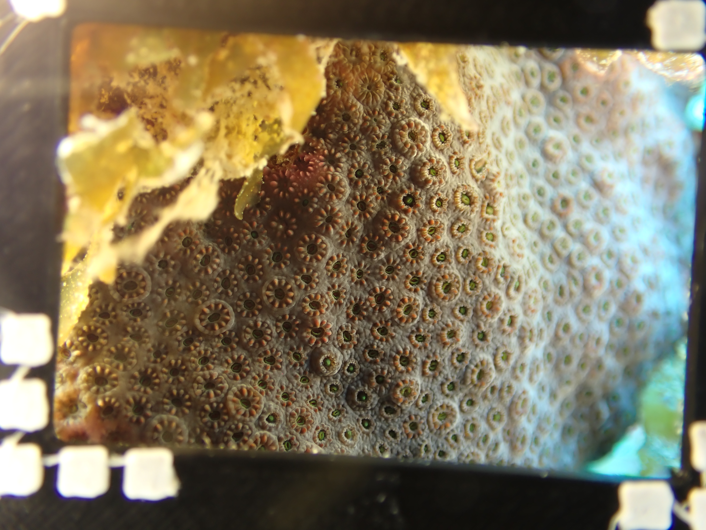

This directory contains data, figures, and scripts for analyzing Nelly and Giorgio's *Madracis* morphological data.

During the 2022 field trip to Curaçao, standardized macrophotographs were taken of *Madracis* sampled for WGS. From the macrophotographs, several micromorphological traits were quantified: number of septa, intercorallite distance, and corallite area. These measurements were attempted for 15 corallites per macrophotograph. For distance or area based measurements, either a small yellow ruler or a 2mm-sided white square were used as the known distance in the macrophotograph.

`/data`: contains datasheets with micromorphological trait data for each sampled *Madracis*

`/figures`: contains data visualizations generated from `/scripts`

`/scripts`: contains R scripts for analyzing and visualizing the morphological data

